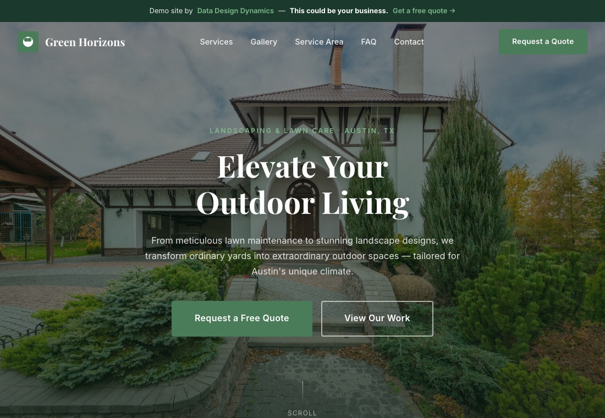
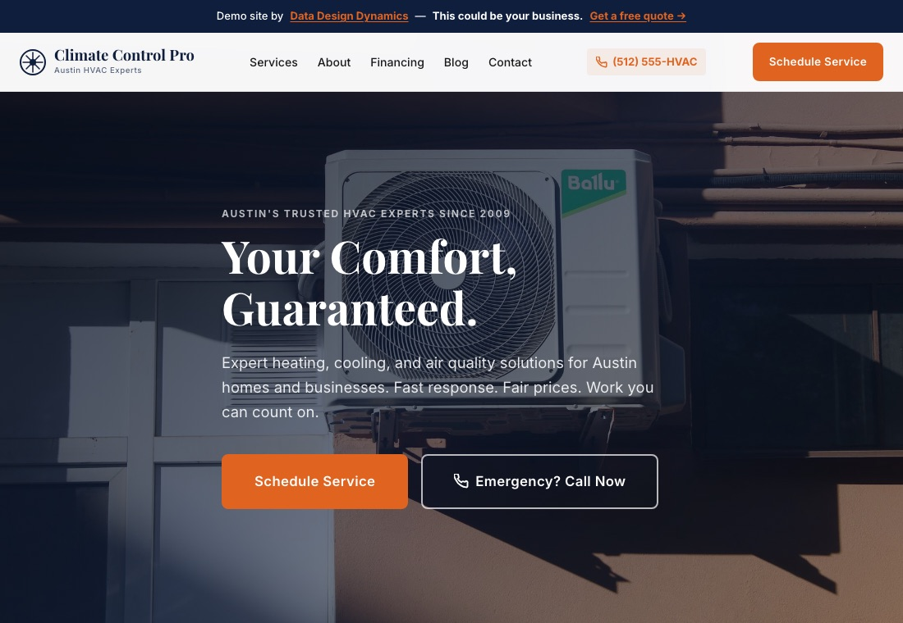
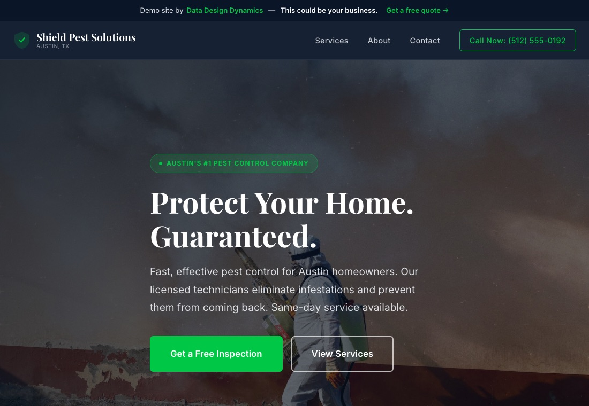

# Web Design Demos

Three responsive marketing sites for fictional local-service businesses, each designed around how a customer finds, compares and contacts a provider. Together they show information architecture, conversion paths and a measurement plan ready for analytics.

| Green Horizons (landscaping) | Climate Control Pro (HVAC) | Shield Pest Solutions (pest control) |
|---|---|---|
|  |  |  |
| 8 pages · [source](green-horizons/index.html) | 16 pages · [source](climate-pro/index.html) | 4 pages · [source](shield-pest/index.html) |

## What the work shows

- **Information architecture:** service, service-area, FAQ, reviews, booking, financing, emergency and blog pages, organized around the questions a homeowner asks before calling.
- **Conversion paths:** calls to action in the header and hero, click-to-call phone links on every HVAC and pest-control page, and short quote and booking forms.
- **Responsive design:** mobile-first CSS with a distinct visual system per brand (type, color, imagery) and a collapsible mobile menu.
- **Accessibility and SEO basics:** semantic landmarks, document language, unique titles and meta descriptions, and descriptive alt text on every image.
- **Measurement plan:** a consent-aware GA4 event contract (`form_start`, `generate_lead`, `select_cta`) with controlled-vocabulary parameters and a pre-launch QA checklist, in [`docs/measurement-and-delivery.md`](docs/measurement-and-delivery.md).
- **Automated quality gate:** [`scripts/validate_static_sites.py`](scripts/validate_static_sites.py) checks every page for required metadata, image alt text, broken local links and assets, and stray credentials or local paths. It runs in GitHub Actions on every push.

## Repository structure

```text
green-horizons/        # 8 pages, styles.css, assets/
climate-pro/           # 16 pages, styles.css, assets/
shield-pest/           # 4 pages, styles.css, assets/
scripts/
  demo-forms.js            # local-only form confirmation
  validate_static_sites.py # quality gate
docs/
  measurement-and-delivery.md
  screenshots/
```

## Run locally

```bash
python3 -m http.server 8000
# open http://localhost:8000/green-horizons/
python3 scripts/validate_static_sites.py
```

No install or build step is needed.

## Notes

- The businesses, people, testimonials, phone numbers and addresses are fictional.
- Forms validate in the browser and show a local confirmation. Nothing is sent anywhere, with or without JavaScript.
- No analytics tags are included. The measurement plan describes what an owner would add after consent is set up.
- Code is MIT-licensed; images and brand content aren't licensed for reuse. See [`LICENSE`](LICENSE).
